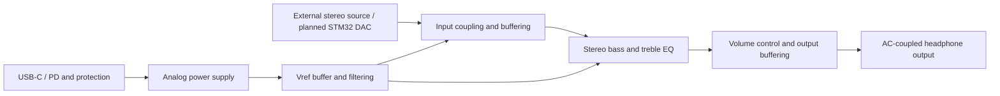

# Audio Project V2

**01 — Analog & Audio Electronics** · Altium Designer · LTspice · PCB Design

[Project index](../README.md) · [Design status](Hardware/Documentation/design-status.md) · [Simulation notes](Hardware/Documentation/simulation.md)

A second-generation analog audio board for an STM32-based audio system. This repository contains Altium design files, LTspice simulations, and documentation for ongoing development and hardware validation.

**Status: in development.** Board fabrication, system testing, and performance validation have not been verified. STM32 firmware is not included.

## Engineering Focus

| Area | Project scope | Current evidence |
| --- | --- | --- |
| Analog & audio | Input buffering, stereo bass/treble EQ, volume control, and headphone output | Altium schematics and LTspice circuit files; final output amplifier selection remains to be reconciled |
| Power electronics | USB-C / PD input, protection, analog regulation, and buffered reference voltage | Power and Vref schematics; hardware validation remains outstanding |
| Embedded integration | Audio input from an STM32-based playback system | Planned system interface; MCU, DAC architecture, and sample rate still need confirmation |
| PCB design | Component placement, routing, grounding, and power distribution | Native Altium PCB and footprint library included; layout completion and DRC have not been verified |

This is one complete audio project. Its EQ, power supply, and reference-voltage circuits are subsystems, not separate portfolio repositories. See the [portfolio repositories](../README.md#portfolio-repositories) for the broader organization.

## System Overview



Refer to the Altium schematics for actual connections. The top sheet connects Vref to the EQ sheet; the physical `Left_in` / `Right_in` interface, STM32 device, and DAC architecture still require confirmation.

## Design Preview

### Audio EQ and Buffers


### Power Supply


### Reference Voltage


The previews are stored in this repository. The third image shows the reference-voltage schematic, not PCB layout.

## Repository Structure

```text
Headphone-Amplifier/
├── README.md
├── Hardware/
│   ├── Schematics/       # Altium project, schematic sheets and symbol library
│   ├── PCB/              # PCB document and footprint library
│   ├── Simulation/       # Original LTspice circuits, symbols and models
│   └── Documentation/    # Design status and simulation notes
├── Images/
│   ├── Power_Supply.png
│   ├── EQ.png
│   └── Vref.png
└── THIRD_PARTY_NOTICES.md
```

No PCB layout screenshot has been supplied.

## Getting Started

1. Open `Hardware/Schematics/STM32_LowNoise_Amplifier.PrjPcb` in Altium Designer. The screenshots were captured using version 26.2.0.
2. Open `Hardware/Simulation/LTspice/DAC_Amp.asc` or `Bass_Treble.asc` in LTspice. Required models and custom symbols are located in the same directory.
3. Review the analysis directives and output nodes in the [simulation notes](Hardware/Documentation/simulation.md) before running a simulation.

## Next Steps

- Confirm the audio input connector, STM32 DAC or external DAC, and sample rate.
- Reconcile output amplifier selection, BOM part numbers, and potentiometer footprints.
- Complete project validation, PCB layout and routing, and manufacturing checks.
- Add actual LTspice window screenshots and hardware measurement records.

## PCB Design Documentation

The native board document and footprint library are in [Hardware/PCB](Hardware/PCB/). PCB work is part of this audio project and is tracked alongside the circuit design.

Before presenting the board as manufacturing-ready, add the layer stack-up, placement and routing screenshots, grounding and return-path rationale, electrical validation and DRC results, and fabrication outputs. Record bench measurements separately from simulation results.

## Licensing

No open-source license has been selected. The repository is intended to remain private initially. Third-party device models retain their respective copyright notices and terms; see [Third-Party Notices](THIRD_PARTY_NOTICES.md).
