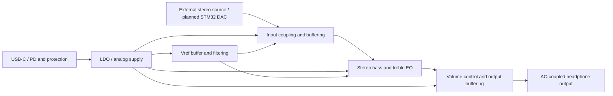
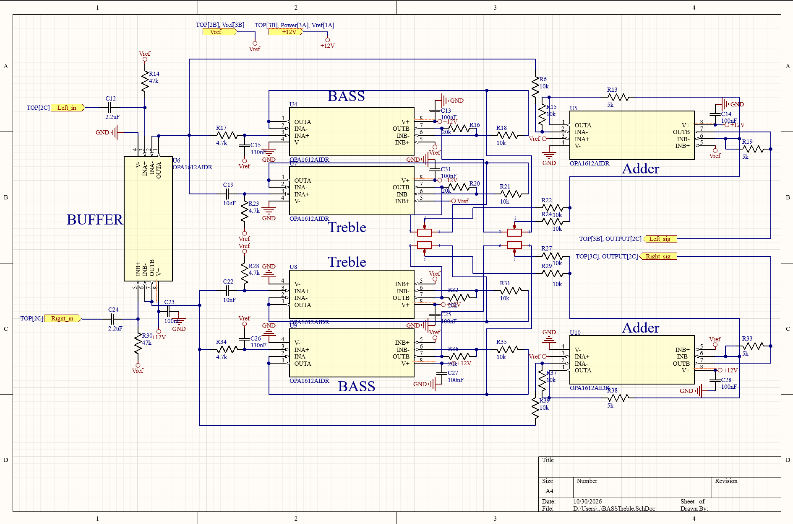
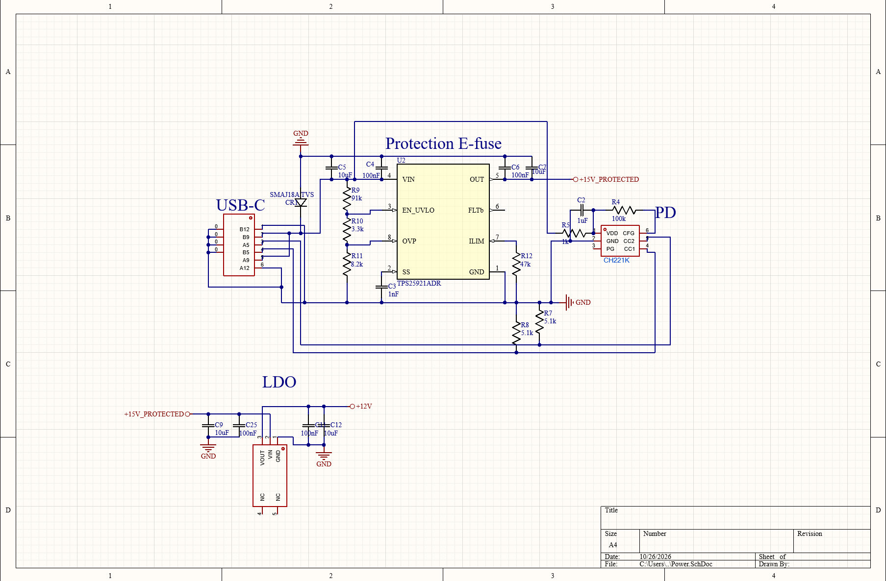
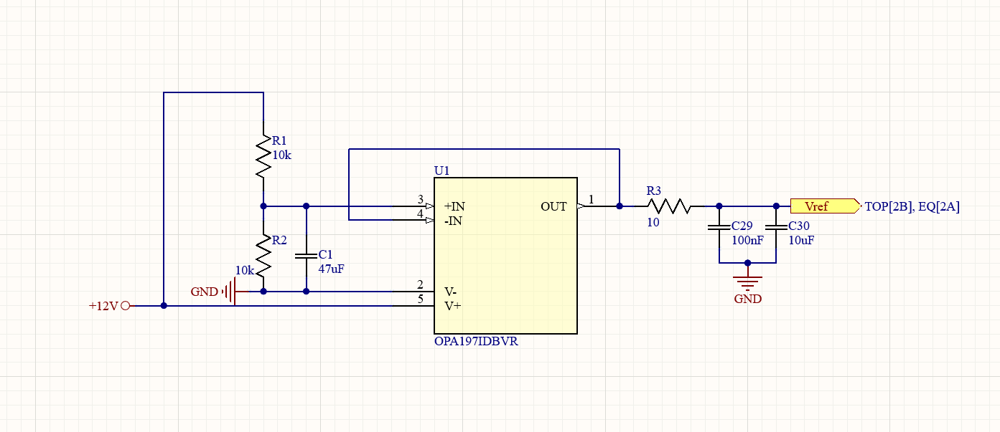
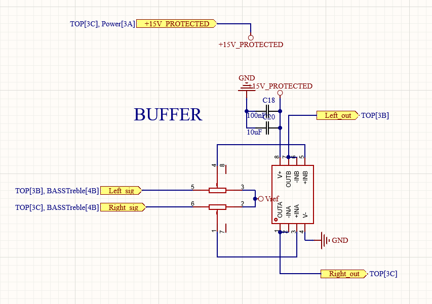

# Headphone Amplifier with Analog EQ

**OPA1612-based analog design · Bass/Treble EQ · USB-C PD · LDO supply · Four-layer PCB target**

**Work in Progress** — Native circuit, PCB, and simulation files are available. PCB stack-up, routing, DRC, fabrication, and measured performance have not been verified. The final output amplifier selection still needs reconciliation across the schematic, BOM, and simulation.

[Project index](../README.md) · [Design notes](Documentation/Design-Notes.md) · [Component selection](Documentation/Component-Selection.md) · [Test results](Documentation/Test-Results.md)

## 01 — Project Overview

This second-generation analog audio board is intended to provide headphone amplification and adjustable stereo bass/treble control for an STM32-based audio system. The analog EQ adjusts the signal independently of the playback firmware. The OPA1612 design direction is subject to component and model reconciliation before performance claims are made.

The EQ, USB-C power input, regulation, and reference-voltage circuits remain part of this complete project. STM32 playback firmware is outside this project folder.

## 02 — Key Features

| Feature | Scope and current status |
| --- | --- |
| Stereo audio signal path | Input coupling/buffering, tone control, volume control, and headphone output |
| Analog bass/treble EQ | Native EQ schematic and LTspice parameter-sweep circuit included |
| USB-C / PD power | Power schematic included; negotiation and hardware behavior not yet validated |
| LDO supply and reference voltage | Supply and Vref circuits included; ripple, noise, and thermal performance await measurement |
| Four-layer PCB | Design target; included PCB document requires stack-up, routing, and DRC verification |

## 03 — System Architecture



This is a functional overview, not a substitute for the schematics. Confirm the physical Left_in / Right_in connections, final source/DAC architecture, and reference distribution against the native design. An exported block-diagram image and schematic PDF have not been added.

## 04 — Circuit Design

The native [Altium project](Hardware/Altium/STM32_LowNoise_Amplifier.PrjPcb) includes TOP, EQ, Power, and Vref sheets, the PCB, and local symbol/footprint libraries.

### Audio EQ and Buffers



### Power Supply



### Reference Voltage



### Reference Voltage



See [design notes](Documentation/Design-Notes.md) for signal-path, feedback, bias, and protection review items, and [component selection](Documentation/Component-Selection.md) for unresolved device choices. The images above are schematics; no PCB rendering is used as a cover yet.

## 05 — Simulation Results

| Circuit | Saved setup | Evidence status |
| --- | --- | --- |
| [DAC_Amp.asc](Simulation/LTspice/DAC_Amp.asc) | AC sweep from 10 Hz to 100 kHz; 16-ohm output load in the circuit | Source available; not rerun during this reorganization |

Custom symbols remain beside the circuits; model files are in [Models](Simulation/LTspice/Models/). Relative model paths have been updated. See [simulation notes](Documentation/simulation.md) for reproduction steps and model limitations.

[Simulation/Results](Simulation/Results/) is reserved for actual frequency-response and transient-response exports. No placeholder graphs or simulated performance numbers are presented.

## 06 — PCB Design

Open [PCB1.PcbDoc](Hardware/Altium/PCB1.PcbDoc) with the project and included [libraries](Hardware/Altium/Libraries/).

The four-layer stack-up, ground and return paths, power distribution, decoupling, component placement, routing, and DRC must be reviewed and documented before fabrication. [Images/PCB](Images/PCB/) is reserved for top/bottom and 3D views; [Images/Assembly](Images/Assembly/) is reserved for real board photos.

[Hardware/Manufacturing](Hardware/Manufacturing/) contains reserved Gerber and Drill directories. Add the actual BOM, pick-and-place file, and stack-up PDF only when exported and checked for a specific board revision.

## 07 — Measurements

No bench results have been recorded here. [Measurements](Measurements/) is reserved for real data; [Test-Results.md](Documentation/Test-Results.md) records the current status and proposed test plan.

Planned checks include frequency response, clipping and output load behavior, supply ripple, noise, and distortion with documented equipment and conditions. Simulation curves must not be labeled as hardware measurements.

## 08 — Design Challenges & Revisions

- Reconcile OPA1612-related design choices and the output-stage device with the BOM and simulation models.
- Resolve final input/DAC architecture and physical connector wiring.
- Check resistor/capacitor part numbers and potentiometer, headphone, and USB-C footprints.
- Verify the PCB stack-up and run electrical validation and DRC.
- Record reproducible simulation plots, then fabrication and bench evidence.

The [design-status record](Documentation/design-status.md) retains historical context. See [IMPORT.md](IMPORT.md) for provenance and the directory reorganization. No Rev1/Rev2 fabrication release is claimed. Use project-scoped commits and publish manufacturing files in a release only after a reproducible production revision is ready.

## Project Structure

```text
Headphone-Amplifier/
├── README.md
├── .gitignore
├── IMPORT.md
├── THIRD_PARTY_NOTICES.md
├── Hardware/
│   ├── Altium/
│   │   ├── STM32_LowNoise_Amplifier.PrjPcb
│   │   ├── TOP.SchDoc / EQ.SchDoc / Power.SchDoc / Vref.SchDoc
│   │   ├── PCB1.PcbDoc
│   │   └── Libraries/           # Schlib1.SchLib, PcbLib1.PcbLib
│   └── Manufacturing/
│       ├── Gerber/              # Reserved
│       └── Drill/               # Reserved
├── Simulation/
│   ├── LTspice/                 # Original circuits and custom symbols
│   │   └── Models/              # Required device models
│   └── Results/                 # Reserved
├── Documentation/
│   ├── Design-Notes.md
│   ├── Component-Selection.md
│   ├── Test-Results.md
│   ├── design-status.md
│   └── simulation.md
├── Images/                     # Existing schematic images retained
│   ├── PCB/                    # Reserved
│   └── Assembly/               # Reserved
└── Measurements/               # Reserved
```

Reserved directories contain only .gitkeep so Git can retain them. There are no empty PNG, PDF, or CSV files.

## Getting Started

1. Open `Hardware/Altium/STM32_LowNoise_Amplifier.PrjPcb` in Altium Designer. Included document/library paths are project-relative.
2. Open `Simulation/LTspice/DAC_Amp.asc` or `Bass_Treble.asc` in LTspice, keeping the custom symbols and Models directory in place.
3. Follow the [simulation notes](Documentation/simulation.md), confirm model loading, and record any validation issues. This directory reorganization was checked statically, not by running Altium or LTspice.

## Licensing

No open-source license has been selected, so no LICENSE file is fabricated or added. See [third-party notices](THIRD_PARTY_NOTICES.md) for model and library restrictions.
