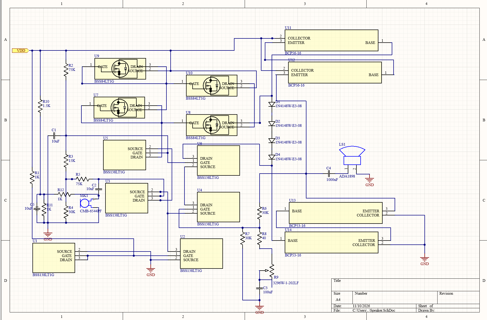
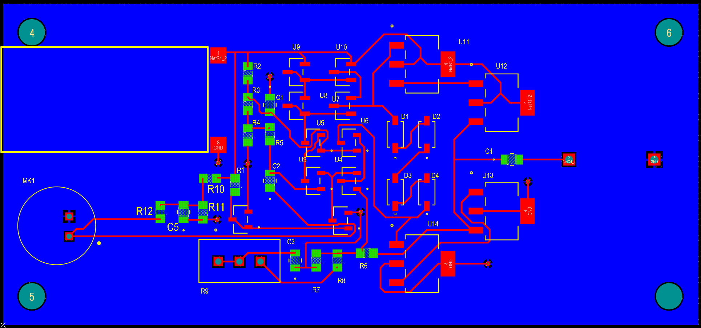
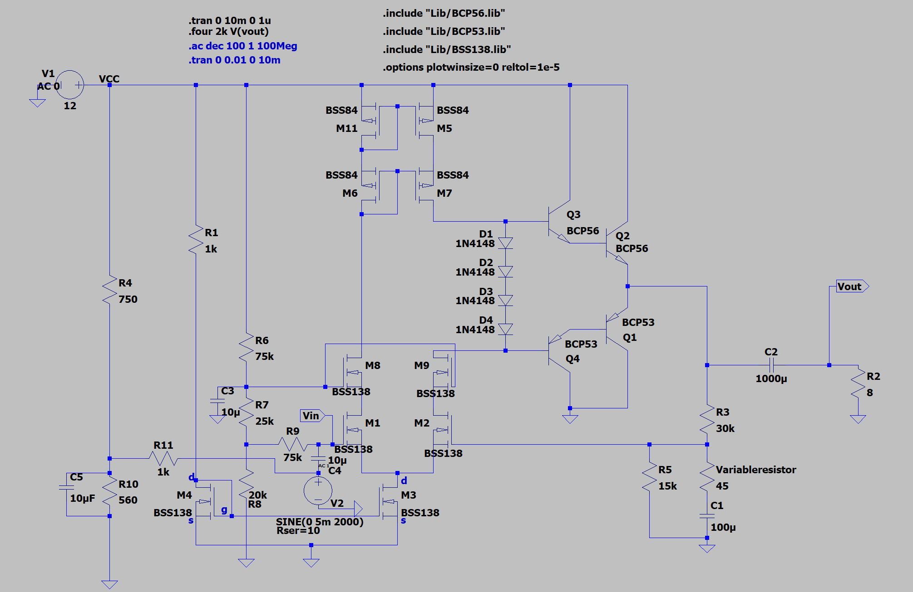
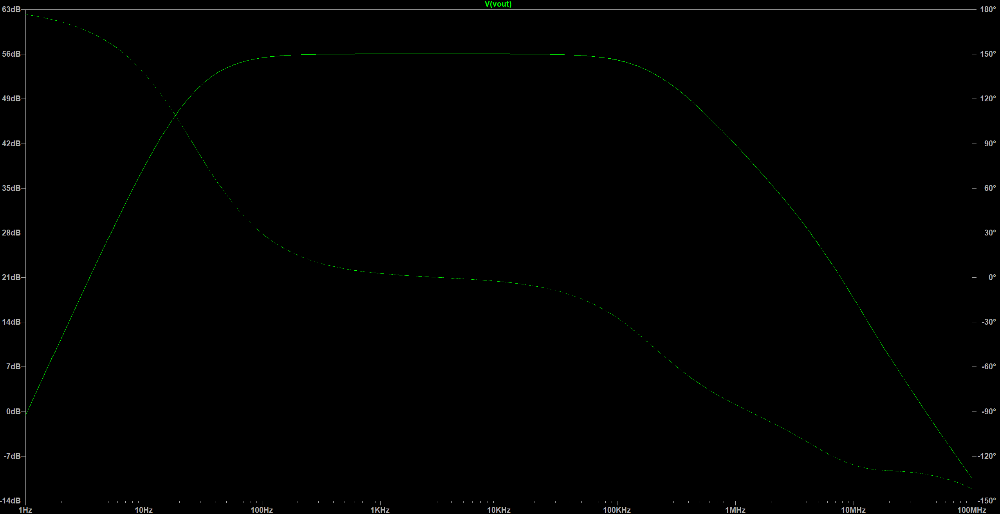
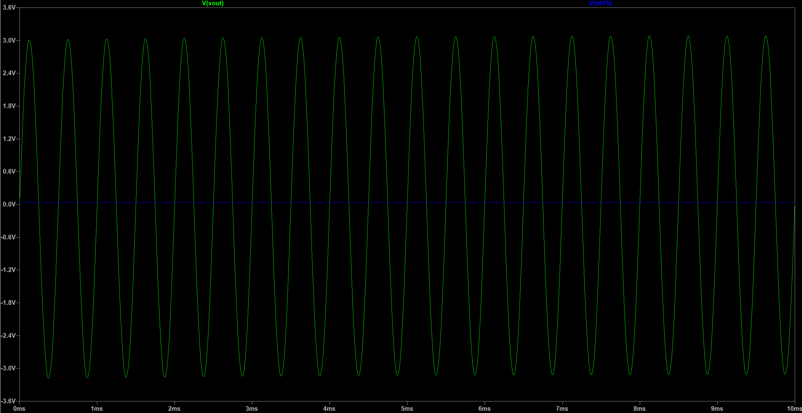

# Microphone-to-Speaker Amplifier

[Back to project index](../README.md)

**Analog Audio Circuit | PCB Design | Hardware Debugging**

**Project status:** Prototype completed — stability issue unresolved, according to the supplied project notes.

This project explores a custom microphone-to-speaker amplifier using discrete transistors. The initial PCB was fabricated and assembled, but unexpected oscillation prevented stable operation. This repository documents the design, available simulation screenshots, and hardware debugging experience.

This documentation is an outline populated from the supplied project history and images. Native design files, simulation data, and bench captures have not yet been imported.

## 1. Design Goals

- Capture a microphone signal, amplify it, and drive a speaker.
- Practice discrete analog circuit design, PCB layout, assembly, and debugging.
- To document: hardware supply voltage, microphone specifications, speaker impedance, target gain, bandwidth, and output power.

## 2. System Architecture

**Microphone → Input bias and coupling → Discrete MOSFET amplification → Complementary BJT output stage → Output coupling capacitor → Speaker**

The supplied schematic shows BSS138 and BSS84 MOSFETs, BCP56/BCP53 output transistors, and a diode bias network. Stage operation, operating points, feedback, and component selection remain to be documented against the native schematic.

## 3. Hardware Design

### Schematic

### PCB Layout

To document: board dimensions, layer stack, power and ground return paths, placement decisions, footprints, and design-rule checks. The PCB screenshot records the layout view; it is not a photograph of the assembled board.

Native project files should be placed in [Hardware/Altium](Hardware/Altium/).

## 4. Simulation

The supplied LTspice screenshots show a 12 V supply, an 8 Ω resistive load, and a 2 kHz sine source with 5 mV peak amplitude. These are simulation settings, not confirmed bench conditions.

### Simulation Circuit

### AC Sweep

The displayed response has a midband magnitude of approximately 56 dB. The circuit screenshot labels the input source AC 1; confirm the plotted transfer function and circuit revision using the original simulation files.

### Transient Response

The screenshot shows approximately 20 output cycles over 10 ms, with output peaks around ±3.1 V. The blue trace is labeled V(n015); its node identity requires the native simulation.

These screenshots do not establish hardware stability, distortion, or measured output power. See [Simulation Notes](Documentation/Simulation-Notes.md) for settings, limitations, and revision differences.

## 5. [Hardware Testing and Debugging](Documentation/Debugging-Notes.md)

## 6. Known Issues and Lessons Learned

- Stable hardware operation was not achieved in the reported prototype.
- Acoustic feedback, microphone bias conditions, electrical coupling, and power-supply coupling remain hypotheses.
- Verify component values and operating points before full-system testing.
- Record exact test points, circuit revisions, and measurement conditions.
- Simulation and hardware evidence must be evaluated separately.

## 7. Repository Structure

- [Images](Images/): supplied schematic, PCB layout, and simulation screenshots.
- [Documentation/Debugging-Notes.md](Documentation/Debugging-Notes.md): bench observations and debugging results.
- [Documentation/Simulation-Notes.md](Documentation/Simulation-Notes.md): screenshot evidence and reproducibility outline.
- [Hardware/Altium](Hardware/Altium/): reserved for native hardware sources.
- [Simulation/LTspice](Simulation/LTspice/): reserved for native simulation sources.

The folder name remains Microphone-Preamplifier within the parent repository; the project title reflects the supplied microphone-to-speaker design.
